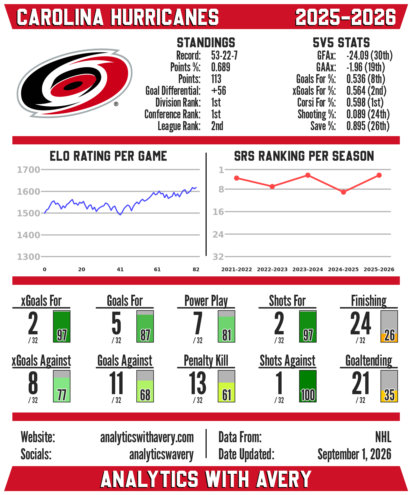

# NHL Team Stat Cards

## Description
Generates visually appealing stat cards for each NHL team from prepared card data. The data collection, ratings (Elo and SRS), and card data assembly live in the separate [nhl-stats-collection-and-processing](https://github.com/AveryJD/nhl-stats-collection-and-processing) project, which writes the card-ready CSV files this project reads.

<p align="center">
  
  <br />
  <em>Example team card.</em>
</p>


## Installation
### Prerequisites
* **Python 3.9+**
* **GTK+ Runtime** (Required for CairoSVG to render vector graphics to PNG)

### Setup
1. **Clone the repository:**

```bash
git clone https://github.com/AveryJD/nhl-team-cards.git
cd nhl-team-cards
```

2. **Create a data folder in the project root:**

```bash
mkdir data
```

This folder will hold the card data (data/card_data/team_card_data/) and the card assets (data/card_data/assets/fonts and data/card_data/assets/team_logos), both produced by the stats collection project.

3. **Create a virtual environment:**

```bash
python -m venv venv
source venv/bin/activate  # On Windows: venv\\Scripts\\activate
```

4. **Install the package (and its dependencies):**

```bash
pip install -e .
```

A requirements.txt is also included if it is prefered to install from that directly

```bash
pip install -r requirements.txt
```


## Usage
Copy the card_data folder (contains team card data and assets, as well as player card data but that can be deleted) from the stats collection project's data folder into this project's data folder, then generate cards.

Call functions in src/team_card_project/__main__.py to choose what cards to generate:
```python
card_generation.make_team_card('Colorado Avalanche', '2025-2026', 'dark')

"""
Parameters:
  Team Full Name ('Location Name')
  Season ('YYYY-YYYY')
  Card Mode ('Light' or 'Dark')
"""
```

Execute the following script:
```bash
python -m team_card_project
```

Generated card PNGs will be saved to the 'team_cards' folder.


## License
This project is licensed under the GNU General Public License v3.0. See the LICENSE file for details.


## Disclaimer
This project is for educational and analytical purposes and is not affiliated with the NHL.
